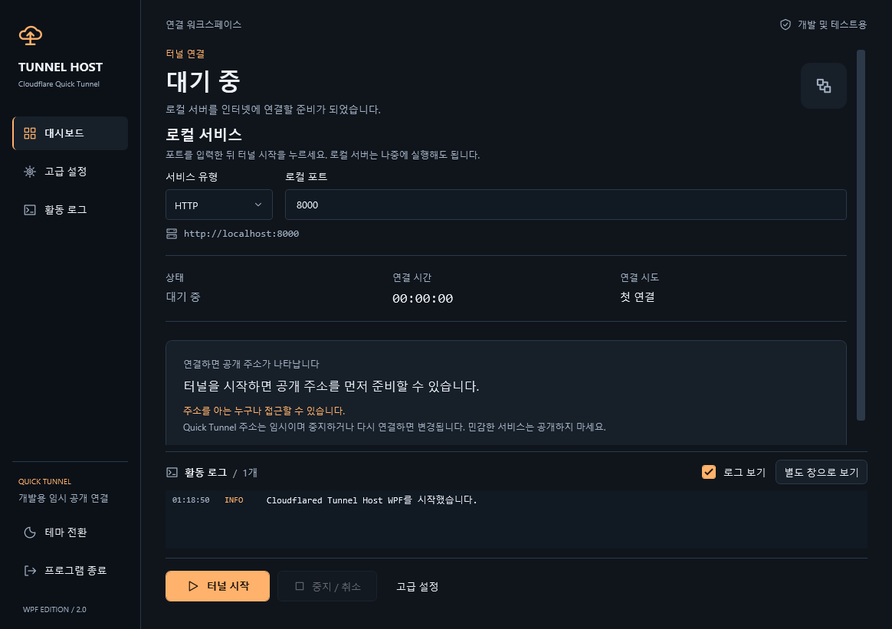
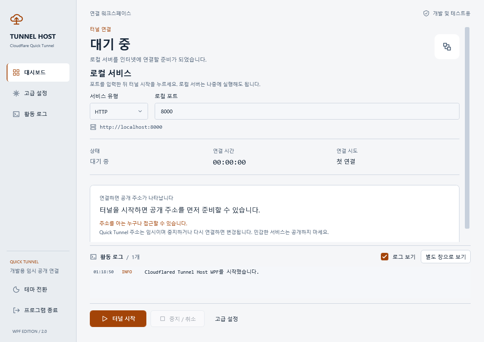

# Cloudflared Tunnel Host

[](https://dotnet.microsoft.com/)
[](https://www.microsoft.com/windows)
[](LICENSE)
[](https://github.com/tharu8813/CloudflaredTunnelHost/releases/latest)

**Cloudflared Tunnel Host**는 Cloudflare Quick Tunnel을 간편하게 관리할 수 있는 .NET 8 WPF 기반 Windows 애플리케이션입니다.<br />
로컬 서버를 인터넷에 노출시킬 수 있으며, GUI를 통해 쉽게 터널을 시작하고 관리할 수 있습니다.

## 주요 기능

- HTTP/HTTPS 로컬 서버 연결과 임시 공개 주소 발급
- 공개 주소 복사·브라우저 열기·로컬 QR 코드 생성
- 다크/라이트 테마와 메인 화면의 실시간 활동 로그
- 별도 로그 창의 검색·필터·복사·저장, 자동 재연결과 시스템 트레이 지원

## 스크린샷

현재 WPF 대시보드의 시작 화면입니다. 메인 하단에서 최근 로그를 확인하고 별도 로그 창을 열 수 있습니다.

**다크 테마**



**라이트 테마**



## 사용 방법

1. 로컬 웹 서버의 HTTP/HTTPS 유형과 포트를 선택합니다.
2. **터널 시작**을 누릅니다. cloudflared가 없으면 자동 설치합니다. 로컬 서버가 없으면 **로컬 서버 대기**로 표시되며, 서버를 나중에 실행해도 같은 주소를 사용합니다.
3. 공개 주소가 발급되면 복사·브라우저·QR 버튼을 사용할 수 있습니다. 메인 하단에서 활동 로그를 확인하고, 사이드바의 **활동 로그**나 **별도 창으로 보기**로 검색·필터·저장 기능을 사용합니다.
4. **중지 / 취소**는 터널과 진행 중인 작업을 멈추고, **프로그램 종료**는 앱을 완전히 종료합니다.

주소 발급과 연결 완료는 구분해서 표시합니다. `Ctrl+L`은 주소 복사, `Ctrl+S`는 설정 저장, `Ctrl+Shift+L`은 로그 창 열기이며, QR·로그 창은 `Esc`로 닫을 수 있습니다.

Quick Tunnel은 개발·테스트용 임시 연결입니다. 공개 모드에서는 주소를 아는 누구나 접근할 수 있으며, 재연결하면 주소가 바뀔 수 있습니다.

## 빌드 방법

### 개발 환경

- Windows 10/11 x64
- .NET 8.0 SDK 이상
- Visual Studio를 사용하는 경우 .NET 데스크톱 개발 워크로드

### 빌드 단계

```powershell
git clone https://github.com/tharu8813/CloudflaredTunnelHost.git
cd CloudflaredTunnelHost
dotnet build CloudflaredTunnelHost.sln -c Release
dotnet run --project CloudflaredTunnelHost.csproj -c Release
```

설정 위치, 보안 옵션, 테스트와 배포 방법은 [개발 및 상세 동작](docs/DEVELOPMENT.md), 실제 검증 결과는 [VALIDATION.md](VALIDATION.md)를 확인하세요.

## 버그 리포트

버그를 발견하셨나요? [Issues](https://github.com/tharu8813/CloudflaredTunnelHost/issues)에 등록해주세요.

## 라이선스

이 프로젝트는 GPL-3.0 라이선스를 따릅니다. 자세한 내용은 [LICENSE](LICENSE) 파일을 참조하세요.
